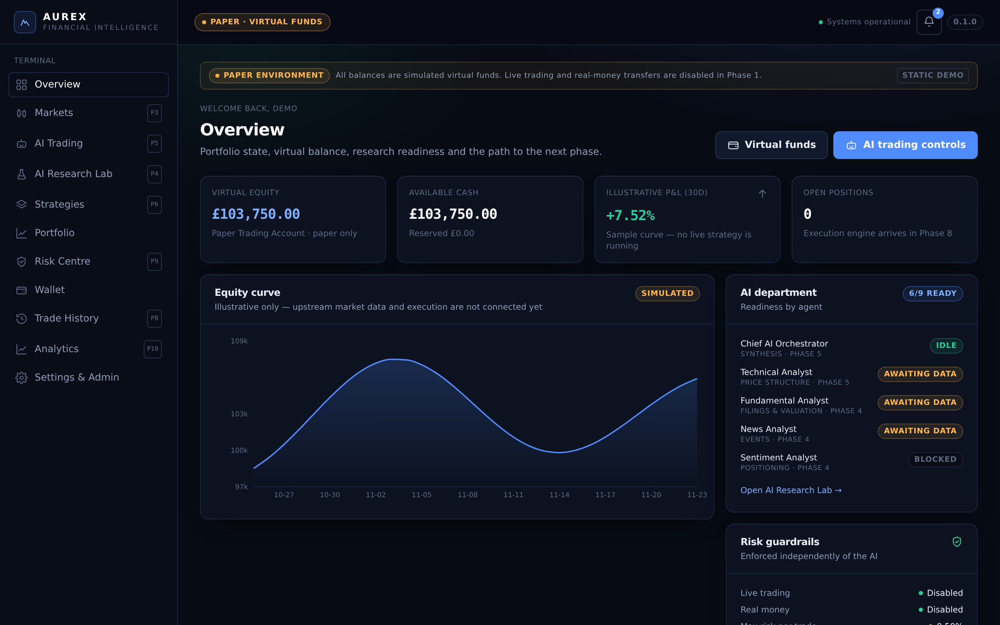

# AUREX AI — Autonomous Trading & Financial Intelligence Platform

**Version 0.1.0 · Phases 1–12 (blueprint complete)** · paper trading only · no real money · no broker execution

AUREX AI is a multi-market quantitative trading and financial research platform. It combines
market-data ingestion, specialist AI research agents, quantitative models, strategy evaluation,
portfolio simulation, deterministic risk controls and automated order execution — with the explicit
goal of *identifying statistically defensible opportunities, explaining its reasoning and declining
to trade when evidence is insufficient*.

> **This repository contains all twelve blueprint phases (Foundation, Accounts, Market Data, Research AI, AI Desk, Model Engineering, Backtesting, Paper Execution, Risk Engine, Analytics, Security & Reliability, Readiness).**
> There is no live trading, no broker connection, no payment processing, no customer money and no
> performance claim anywhere in this codebase. Scope boundaries: [`phase-1.md`](docs/architecture/phase-1.md),
> [`phase-2.md`](docs/architecture/phase-2.md), [`phase-3.md`](docs/architecture/phase-3.md),
> [`phase-4.md`](docs/architecture/phase-4.md), [`phase-5.md`](docs/architecture/phase-5.md),
> [`phase-6.md`](docs/architecture/phase-6.md), [`phase-7.md`](docs/architecture/phase-7.md),
> [`phase-8.md`](docs/architecture/phase-8.md), [`phase-9.md`](docs/architecture/phase-9.md),
> [`phase-10.md`](docs/architecture/phase-10.md),
> [`phase-11.md`](docs/architecture/phase-11.md), [`phase-12.md`](docs/architecture/phase-12.md).

---

## Live demo (static build)

GitHub Pages serves a **static demo build** of the terminal. Pages cannot run Python or Postgres, so
the demo ships an in-browser implementation of the same API contracts — including a real double-entry
ledger — persisted to `localStorage`.

- **Demo:** <https://muhammadhaiderabbas.github.io/LmArenaAIBotTrading/> — this URL serves the
  running app. (GitHub Pages for this repo is configured from the root of `main` with Jekyll, so a
  small `index.html` there forwards to the build in `docs/live/`. Repointing Pages at the
  `gh-pages` branch removes the hop — see [`docs/deployment/HOSTING.md`](docs/deployment/HOSTING.md).)
- Sign in with `demo@aurex.ai` / `Demo!Aurex2026`, or register your own (you get a funded paper account)
- The bundle is published from the `gh-pages` branch; see
  [`docs/deployment/HOSTING.md`](docs/deployment/HOSTING.md) for how it is built and redeployed

The demo is a product walkthrough, **not** a security boundary and holds no real value.



---

## What Phases 1–12 deliver

| Area | Delivered |
| --- | --- |
| Architecture | Modular monolith, clearly separated domains, documented boundaries |
| Backend | FastAPI + Pydantic v2, OpenAPI docs at `/docs`, health checks |
| Database | PostgreSQL (SQLite for dev/test), 44 tables across 9 domains, Alembic migration |
| Financial core | **Double-entry ledger** — every transaction balances to zero, reconciliation records |
| Auth | Registration, login, JWT access/refresh rotation, session revocation, password policy, rate limiting |
| RBAC | `admin` / `analyst` / `user`, server-side guards, user isolation on every resource |
| Audit | Append-only audit trail of all sensitive actions, admin-visible |
| Accounts | Paper trading accounts, virtual opening balance, virtual deposit/withdraw |
| Frontend | React 18 + TypeScript + Vite + Tailwind, 13 screens, design system, responsive shell |
| Market data (P3) | 4 provider adapters with ordered fallback, 18-instrument registry, candles, quotes, sessions |
| Indicators (P3) | SMA, EMA, RSI, ATR, MACD, Bollinger, volatility — verified against published references |
| Data quality (P3) | Gaps, duplicates, outliers, staleness and provider errors recorded with severity |
| Markets UI (P3) | Screener, candlestick chart with overlays, indicator readout, provider health |
| Research ingestion (P4) | 6 keyless sources (ECB, BoE, Fed, SEC EDGAR, Dow Jones, BBC), HTML + PDF bodies, dedupe, chunking, entity tagging |
| RAG (P4) | 256-dim lexical embeddings with auditable synonym expansion, rank-then-hydrate retrieval, per-document diversity |
| Verified reports (P4) | Extractive `extractive-v1` builder — every claim cites a passage, failed claims shown not dropped |
| Safety (P4) | Prompt-injection detection, licence-aware storage, documents always untrusted |
| Research UI (P4) | Source register with licence and failure state, claim/verdict evidence view, flagged documents |
| AI agents (P5) | 6 deterministic specialists (technical, regime, news, portfolio, quality, quantitative); 2 registered as explicitly unbuilt |
| Orchestrator (P5) | Structured findings with evidence-or-absence, conflict detection, refusal when evidence is thin |
| AI Desk UI (P5) | Findings with facts/interpretation/uncertainty split, confidence labelled as a rule score, blocked reason shown |
| DX | Docker Compose (Postgres + Redis + API + web), seed script, 527 backend + 285 frontend tests; CI workflow in `docs/deployment/CI_WORKFLOWS.md` |

| Model engineering (P6) | 15 leakage-tested features, forward-only time splits, numpy logistic training, 4-fold walk-forward |
| Evaluation (P6) | Per-slice metrics with `is_out_of_sample`, majority-class baseline, edge over baseline, Brier, calibration slope and reliability bins |
| Promotion control (P6) | Out-of-sample gate (edge ≥ 0.02, AUC ≥ 0.52, ≥60% folds positive), staff-only promotion, `replaced_version_id`, rollback, `FORCED OVERRIDE` audit stamp |
| Model registry UI (P6) | Version history with checksums, evaluation and walk-forward tables, reliability bins, blocked-promotion state, advisory drift alerts |
| Backtesting (P7) | Event-driven simulator: next-bar fills, stops resolved against the bar's low, spread/commission/slippage/financing on both sides |
| Evaluation (P7) | Sharpe, Sortino, max drawdown, win rate, profit factor, exposure, turnover, cost drag — each with buy-and-hold over the identical window |
| Strategy gate (P7) | ≥20 trades, net ≥ 0, edge over buy-and-hold ≥ 2%, drawdown better than −25%, Sharpe ≥ 0.30 |
| Strategy control (P7) | Backtests can only move a strategy to `testing`; validation is staff-only and needs a passing run |
| Drift monitoring (P6) | Standardised feature shift against the stored training reference; advisory text only, never an automatic action |
| Paper execution (P8) | Deterministic validation (freshness, cash, position, no shorts), simulated venue with 15% participation cap and up to 4 degrading bites |
| Fills & accounting (P8) | Every fill stores reference price, measured slippage and commission; each posts a balanced double-entry transaction |
| Positions (P8) | Long-only book marked to the latest close; reconciled against `INVESTMENT` and `REALISED_PNL` over open *and* closed positions |
| Execution UI (P8) | Equity, unrealised/realised P&L, order history with rejection reasons, and what the venue is not |

| Risk engine (P9) | 11 deterministic rules evaluated before any order: per-trade risk, daily loss, drawdown, positions, exposure, concentration, correlation, leverage, spread, order rate, kill switch |
| Risk sizing (P9) | Per-trade risk measured against the stop, not the notional — an oversized order is **reduced** to the budget, with the original quantity kept in the audit log |
| Circuit breaker (P9) | `OPEN` (metric-tripped, auto-clearable) vs `MANUAL` (human, staff-only clear); the distinction stops an auto-reset undoing an emergency stop |
| Emergency stop (P9) | Staff-only, cancels pending orders, records exposure left open, and **does not liquidate** — closing positions is a separate policy decision |
| Risk Centre UI (P9) | Limits with their meaning, live exposure/drawdown, per-decision rule traces, breaker controls, and what the controller is not |

| Performance analytics (P10) | Net return, Sharpe, Sortino, max drawdown, win rate, profit factor, turnover and exposure — each computed from recorded fills |
| Metric honesty (P10) | A metric the sample cannot support is `null` with a reason: no zero Sharpe on three observations, no "infinite" profit factor |
| Curves (P10) | Marked equity rebuilt from fills (not today's book) against equal-weight buy-and-hold of the instruments actually traded |
| Attribution (P10) | Realised P&L split by instrument and by the strategy that opened it |
| Analytics UI (P10) | Equity vs benchmark, cost breakdown, per-metric definitions, the report's own caveats, and what the page refuses to do |
| Tamper-evident audit (P11) | Every audit entry sealed into a sha256 hash chain in a separate `audit_seals` table, so an edited *or deleted* row breaks verification and names the first broken sequence |
| MFA (P11) | RFC 6238 TOTP, single-use recovery codes, and a login that returns a challenge token instead of a session until the second factor is present |
| Secrets at rest (P11) | Encrypt-then-MAC envelope for persisted secrets; the TOTP secret is never stored readable |
| Backups & recovery (P11) | Backup, checksum manifest, restore-into-scratch and a recovery drill that fails loudly: `python -m app.cli drill` |
| Operational monitoring (P11) | Eight checks — stale data, quality events, order bursts, rejection rate, breakers, drift, audit chain, reconciliation — read-only, worst-of status |
| Broker sandbox (P12) | Handshake, clock probe, submit and disconnect against a sandbox venue, with latency and skew recorded per session. **No live adapter exists** — `require_sandbox` raises before a credential is read |
| Compliance assessment (P12) | 24 items across blueprint §13's UK categories, every status resolved from evidence in the running system, every blocker naming what would unblock it |
| Release gate (P12) | A stage machine over the three business stages; blocking vs informational checks are data; advancing to live is refused and audited |
| Readiness UI (P12) | `/readiness`: live-ready **NO** as the headline, the blocking list, the gate, and what the page refuses to claim |
| Operations UI (P11) | `/operations`: finding messages rather than a green tick, the sealed trail, the head digest, and what the page refuses to claim |

### Explicitly **not** in Phase 12

No live trading and no path to it, no real broker contract, no regulatory opinion, no
counsel, no KYC provider, no load test and no point-in-time recovery. The assessment
returns `live_ready: false` with eight blocking items, each naming its unblocking
condition — see [`phase-12.md`](docs/architecture/phase-12.md) §6.

### Explicitly **not** in Phase 11

No enforced MFA gate (reported, not blocking), no IP allowlisting, no automated CVE
scanning in CI, no load test against a production-like deployment, no point-in-time
recovery, and no real broker credentials for least-privilege rules to apply to. Each of
these is listed with its reason in [`phase-11.md`](docs/architecture/phase-11.md) §7.

### Explicitly **not** in Phase 10

The autonomous loop, forward projections, an index benchmark, historical exposure
snapshots, any broker adapter, automatic liquidation, portfolio covariance modelling,
stop-loss order management, short selling, leverage and deep-learning families.

The autonomous loop, any broker adapter, automatic liquidation, portfolio covariance
modelling, stop-loss order management, short selling, leverage, parameter
optimisation, streaming feeds, deep-learning families, and any probability→stance
conversion.

**No AI proposal in this platform is tradeable, and there is no order path to
reach.** Every run stores `tradeable: false` with the reason, a test asserts it
across symbols, and `/api/v1/ai/overview` reports `tradeable_proposals` so a
regression would show on a dashboard. Phase 9 owns the risk controller that will
stand between a proposal and any order.

**No model can promote itself or change a trading rule.** Training always writes a
`candidate`; promotion is a separate staff-only call that re-derives the gate from
stored evaluations and refuses with a reason. `force=true` exists for a human override
and stamps `FORCED OVERRIDE` into the version's audit note. Model weights are stored as
JSON, never pickle, so loading a version is data rather than code execution.

**The shipped demo has zero champions, on purpose.** On real BTC/USD candles the
logistic baseline scored 0.481 out of sample against a 0.504 majority-class baseline
(edge −0.023) and was refused promotion. A pipeline that reported an edge there would
be leaking; the UI says "Nothing has passed the gate" instead of faking a deployment.

**No language model writes the findings.** All six specialists are deterministic
rule sets. The output is honest about being shallow instead of dressing shallow
judgement in fluent prose. Confidence is a documented `rule_score`, never
presented as a probability — calibration needs outcome data that arrives in
Phase 6.

A specialist with no data records an `absence` evidence row rather than a neutral
stance, and the desk returns `refused` when no specialist has usable evidence.

### Explicitly **not** in Phase 4

Real deposits, withdrawals, customer funds, KYC, broker connections, live execution, autonomous
agents acting on research, backtests, streaming feeds. Each has a phase and a gate (see roadmap below).

**Phase 4 does not use a language model to write research.** The report builder is extractive and
deterministic: it lifts a sentence from a cited chunk and verifies the claim against that sentence.
Claims that fail verification are displayed as `unsupported` rather than removed. The retrieval
vector is a hashed lexical embedding, not a neural one, and the model name is stored on every chunk.

**Nothing loaded from the web is trusted.** Retrieved documents are data; instruction-like text is
detected and recorded, and can never cause an action. Link-only publishers are fetched into memory
for analysis and never persisted — the citation says so.

**No instrument is tradable in Phase 3.** The registry exists so data can be analysed, not so
orders can be placed. `is_tradable` is `false` on every instrument and a test enforces it.

### Market data sources

| Provider | Asset classes | Timeframes | Key |
| --- | --- | --- | --- |
| Kraken | crypto | 1m → 1w | none |
| Yahoo Finance | equity, ETF, FX | 1h → 1w | none |
| Twelve Data | equity, ETF, FX | 1h → 1w | `TWELVEDATA_API_KEY` (`demo` = limited symbols) |
| Frankfurter (ECB) | FX | D1 only | none |

Yahoo rate-limits aggressively by IP and is never treated as a single source. Provider failure
is expected: ingestion walks an ordered candidate list, records a quality event, and only fails
the sync when every candidate is exhausted. Full detail in
[`docs/architecture/phase-3.md`](docs/architecture/phase-3.md).

---

## Architecture

```
frontend/          React 18 · TypeScript · Vite · Tailwind · Recharts
  src/components/    design system, shell, environment banner
  src/pages/         one file per product screen
  src/features/      auth + account contexts
  src/services/      transport layer (HTTP ⇄ in-browser demo engine)
  src/lib/demo/      demo fixtures + demo backend implementation

backend/
  app/api/v1/        auth · users · accounts · admin · system routers
  app/core/          config · security (JWT/PBKDF2) · audit · rate limiting
  app/database/      engine, session, declarative base
  app/models/        identity · account · ledger · operations
  app/schemas/       Pydantic v2 request/response contracts
  app/services/      auth · account · ledger (double-entry) · errors
  app/seed.py        idempotent bootstrap (admin + demo trader)
  alembic/           schema migrations
  tests/             35 tests: auth, RBAC, accounting invariants, API contracts

ml/                datasets · features · models · training · evaluation · drift   (Phases 6–7)
infrastructure/    render.yaml · monitoring · deployment                          (continuous)
docs/              architecture · api · security · compliance
```

### Safety boundary (non-negotiable)

AI agents **never** hold broker credentials and **cannot** execute trades. They emit structured
proposals. A deterministic trading service validates each proposal and an *independent* risk
controller can reject it. Only the execution service can submit an order — to the paper broker in
this phase, and to a live broker only after separate approval and regulatory review.

### The ledger is the source of truth

`account_balances` is a cache of entries derived from `ledger_transactions` / `ledger_entries`. It is
never authored by hand and can always be re-derived and reconciled.

```
Event              Debit                    Credit
-----------------  -----------------------  ------------------------
Virtual opening    Cash asset               Opening equity
Virtual deposit    Cash asset               Opening equity
Virtual withdraw   Withdrawal clearing      Cash asset
Buy asset          Investment asset         Cash asset
Sell asset         Cash asset               Investment asset
Trading fee        Fee expense              Cash asset
Realised profit    Cash asset               Realised P&L income
```

Sign convention: `LedgerEntry.amount` is positive for a debit, negative for a credit; each
transaction must sum to exactly zero or it is rejected. Corrections are posted as compensating
transactions — history is never edited.

---

## Quick start

### 1. Docker (recommended)

```bash
git clone https://github.com/MuhammadHaiderAbbas/LmArenaAIBotTrading.git
cd LmArenaAIBotTrading
cp .env.example .env          # then change SECRET_KEY and the bootstrap passwords
docker compose up --build
```

| Service | URL |
| --- | --- |
| Web terminal | http://localhost:5173 |
| API | http://localhost:8000 |
| API docs (Swagger) | http://localhost:8000/docs |
| Health | http://localhost:8000/api/v1/system/health |

Seeded identities (change before any shared deployment):

| Role | Email | Password |
| --- | --- | --- |
| Administrator | `admin@aurex.ai` | `ChangeMe!2026` |
| Demo trader | `demo@aurex.ai` | `Demo!Aurex2026` |

### 2. Local development (no Docker)

```bash
# Backend
cd backend
python -m venv .venv && source .venv/bin/activate
pip install -r requirements.txt
export DATABASE_URL="sqlite:///./aurex_dev.db"
python -m app.seed                 # creates schema + users
uvicorn app.main:app --reload --port 8000

# Frontend (second terminal)
cd frontend
npm install
npm run dev                        # http://localhost:5173
```

### 3. Tests

```bash
cd backend && pytest -q                          # 35 tests
cd frontend && npm run typecheck && npm test
```

---

## Configuration

All configuration is environment-driven (`backend/app/core/config.py`). See
[`.env.example`](.env.example) for the full list.

| Variable | Purpose | Default |
| --- | --- | --- |
| `SECRET_KEY` | JWT signing key — **must** be rotated in any real deployment | dev value |
| `DATABASE_URL` | `postgresql+psycopg2://…` or `sqlite:///…` | sqlite (dev) |
| `ENVIRONMENT` | `development` / `staging` / `production` | development |
| `FIRST_ADMIN_EMAIL` / `FIRST_ADMIN_PASSWORD` | Bootstrap administrator | see above |
| `DEFAULT_PAPER_BALANCE` | Virtual opening balance | `100000` |
| `LIVE_TRADING_ENABLED` | Guardrail — compiled into the API surface | `false` |
| `REAL_MONEY_ENABLED` | Guardrail — no payment rail exists | `false` |
| `CORS_ORIGINS` | Comma-separated allow-list | localhost only |

---

## Security posture (Phase 1)

- PBKDF2-HMAC-SHA256 password hashing (260k iterations, per-password salt)
- Short-lived JWT access tokens + rotating, revocable refresh sessions (hashed at rest)
- Server-side RBAC on every protected route; cross-account reads return 404, not 403
- Fixed-window rate limiting on auth endpoints; per-endpoint request validation
- Security headers (`nosniff`, `DENY` framing, referrer policy, HSTS outside debug)
- Append-only audit trail; secrets via environment, never committed (CI secret guard)
- SQLAlchemy parameterisation throughout — no string-built SQL

Known Phase 1 gaps, tracked for Phase 11: MFA enrolment, email verification, Redis-backed rate
limiting for multi-instance deployments, dependency scanning in CI.

---

## Roadmap

| Phase | Scope | Status |
| --- | --- | --- |
| 01 | Repository, Docker, Postgres, auth, migrations, API structure | **Complete** |
| 02 | Design system, navigation, dashboard, account screens | **Complete** |
| 03 | Instrument registry, provider adapters, historical data, indicators, quality | **Complete** |
| 04 | News ingestion, document extraction, RAG, source-linked reports | **Complete** |
| 05 | Orchestrator, specialist agents, structured outputs | **Complete** |
| 06 | Feature engineering, training, validation, drift monitoring | Planned |
| 07 | Event-driven simulator, costs, slippage, out-of-sample evaluation | Planned |
| 08 | Order lifecycle, simulated fills, positions, accounting | Planned |
| 09 | Limits, circuit breakers, emergency shutdown | Planned |
| 10 | Performance metrics, explanations, reports | Planned |
| 11 | Security testing, recovery, monitoring, load testing | Planned |
| 12 | Broker sandbox, compliance assessment, release preparation | Planned |

Each phase ships as an independently reviewable commit series with tests.

---

## Regulatory note (UK)

This is a private development environment using **virtual capital only**. It accepts no customer
money and executes no real trades.

A future public or live-money service may involve regulated activities depending on instruments,
customer journey, discretion, custody and execution model — including FSMA 2000 / FCA permissions,
client-money and safeguarding rules, financial-promotion restrictions, KYC/AML/sanctions controls,
Consumer Duty, UK GDPR and cryptoasset-specific rules (the FCA's new cryptoasset regime is scheduled
for 25 October 2027).

**A payment gateway does not authorise investment services or client-money handling.** Obtain a
written UK regulatory-perimeter assessment before any customer live trading or financial promotion.

Starting points: [FCA authorisation](https://www.fca.org.uk/firms/authorisation/apply) ·
[FCA cryptoasset regime](https://www.fca.org.uk/firms/new-regime-cryptoasset-regulation) ·
[FCA financial promotions](https://www.fca.org.uk/firms/cryptoasset-financial-promotions)

Nothing in this repository is investment advice. Historical and simulated results do not guarantee
live outcomes.

---

## Licence

Proprietary — all rights reserved. Not for redistribution without permission.
